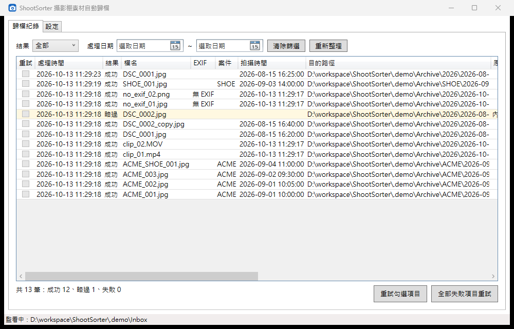
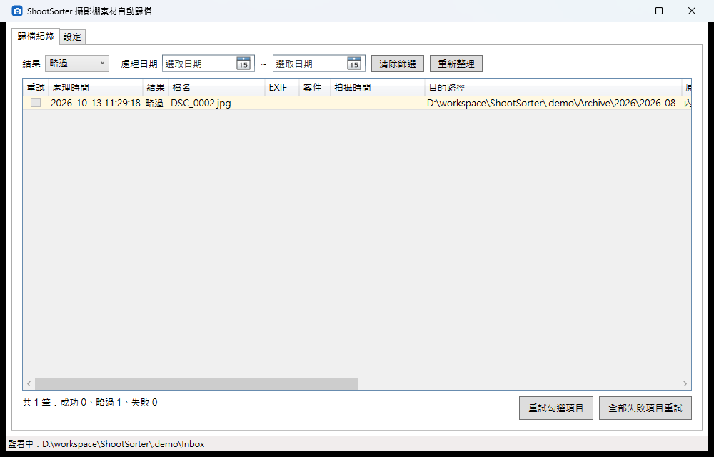
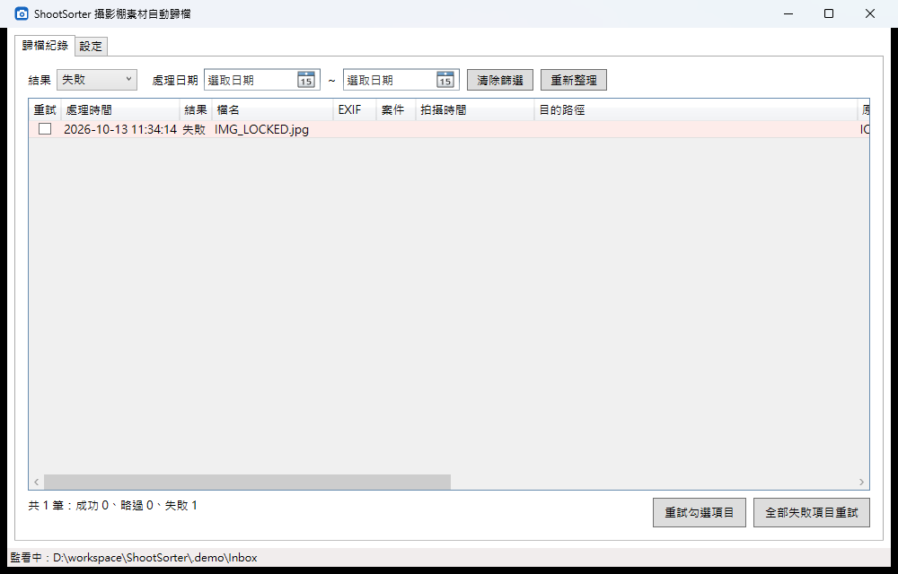
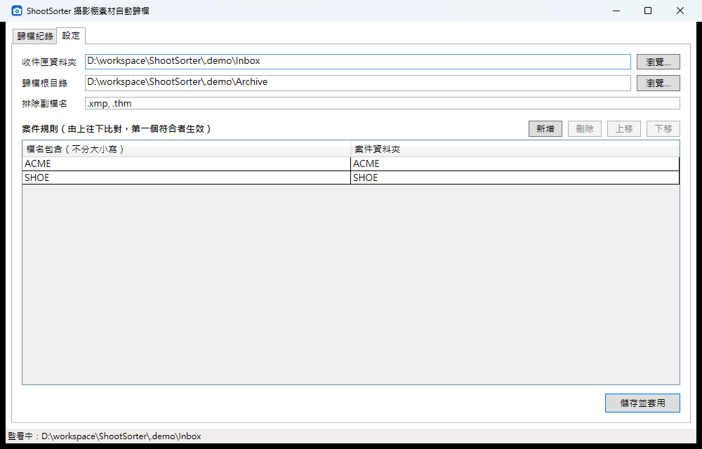
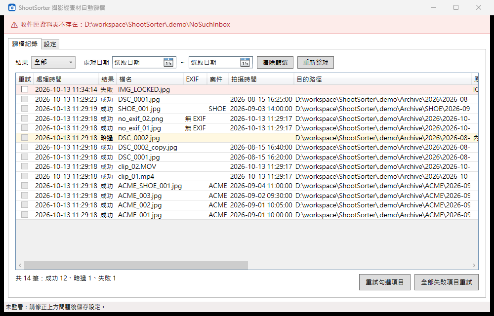
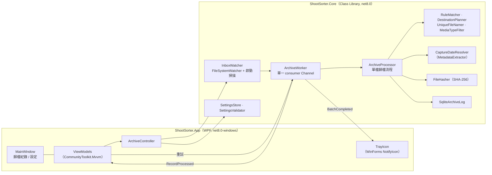

# ShootSorter：攝影棚素材自動歸檔

[](https://github.com/hn83320589/ShootSorter/actions/workflows/ci.yml)

常駐在 Windows 桌面的小工具。它會監看「收件匣」資料夾，把相機卡倒出來的照片與影片，依拍攝日期與案件規則自動搬到正確的歸檔資料夾。每一筆處理結果都會寫入本機 SQLite，失敗的項目可以在畫面上重試。



## 功能

| 功能 | 說明 |
|---|---|
| 監看收件匣 | 啟動後自動監看，新檔案出現就處理；啟動時也會處理收件匣中既有的檔案。只看第一層，不遞迴子資料夾 |
| 依拍攝日期歸檔 | 圖片（JPG/JPEG、PNG、TIF/TIFF、ARW、CR3、NEF）用 EXIF 拍攝日期，歸到 `{根目錄}\{yyyy}\{yyyy-MM-dd}\`；影片（MP4、MOV）與無 EXIF 的圖片用檔案建立日期，無 EXIF 的圖片會在紀錄中標記「無 EXIF」 |
| 案件規則 | 「檔名包含 X」就歸到 `{根目錄}\{案件}\{yyyy-MM-dd}\`。依清單由上往下比對，第一個符合者生效，比對不分大小寫 |
| 重複內容 | SHA-256 相同的檔案不重複歸檔，記為「略過」，原檔移到 `收件匣\_Skipped\`。比對範圍是整個歸檔庫，不分案件 |
| 同名不同內容 | 兩者都保留，新檔名加上 `_001`、`_002`… |
| 排除副檔名 | 設定中列出的副檔名完全不處理，不做任何偵測，也不寫紀錄（例如 `.xmp`）；可以蓋過支援清單 |
| 歸檔紀錄 | 記錄原始路徑、目的路徑、雜湊、拍攝時間、無 EXIF、案件、結果、原因、重試次數、處理時間；可依結果與處理日期區間篩選 |
| 失敗重試 | 勾選後重試，或一鍵重試全部失敗項目；重試結果更新在原本那筆紀錄上。失敗的檔案在重新啟動後被再次處理時，也是更新同一筆，不會重複產生紀錄；原始檔案已被移出收件匣的失敗紀錄，重試時會結案為「略過」 |
| 系統匣常駐 | 最小化後縮到系統匣，雙擊圖示還原；每批處理完跳出摘要，例如「已歸檔 12 筆、略過 1 筆、失敗 0 筆」 |
| 設定持久化 | 存成 JSON，下次啟動自動載入；設定檔不存在、無法讀取、損毀或路徑無效時都會明確提示，不會閃退 |

## 截圖

| 依結果篩選（略過） | 失敗項目（可勾選重試） |
|---|---|
|  |  |

| 設定（規則可調整順序） | 收件匣不存在時的啟動提示 |
|---|---|
|  |  |

## 建置與執行

需要 Windows 10/11 與 [.NET 8 SDK](https://dotnet.microsoft.com/download/dotnet/8.0)（.NET 9 SDK 也可以建置，執行時需要 .NET 8 Desktop Runtime）。

```powershell
dotnet build ShootSorter.sln            # 建置
dotnet test ShootSorter.sln             # 執行 105 個單元測試
dotnet run --project src/ShootSorter.App  # 啟動
```

想發佈成單一資料夾給工作室電腦使用：

```powershell
dotnet publish src/ShootSorter.App -c Release -r win-x64 --self-contained false -o publish
```

### 用範例資料快速體驗

1. 建立 `D:\ShootSorterDemo\Inbox` 與 `D:\ShootSorterDemo\Archive`。
2. 把 `samples/settings.sample.json` 複製成 `%LocalAppData%\ShootSorter\settings.json`，或啟動後在「設定」分頁手動填入並按「儲存並套用」。
3. 啟動程式，把 `samples/media/round1/*` 複製到收件匣，等處理完。
4. 再把 `samples/media/round2/*` 複製到收件匣。

| 範例檔 | 示範的情境 | 預期結果 |
|---|---|---|
| `ACME_001~003.jpg` | 有 EXIF、符合規則 ACME | `ACME\2026-09-01\`、`ACME\2026-09-02\`（依 EXIF，不是複製當天） |
| `SHOE_001.jpg` | 符合規則 SHOE | `SHOE\2026-09-03\` |
| `ACME_SHOE_001.jpg` | 兩條規則同時符合 | 清單在前的 ACME 生效 → `ACME\2026-09-04\` |
| `DSC_0001.jpg` | 無規則、有 EXIF | `2026\2026-08-15\` |
| `DSC_0002.jpg`、`DSC_0002_copy.jpg` | 同內容不同名 | 一個歸檔，另一個記為「略過」並移到 `_Skipped` |
| `no_exif_01.jpg`、`no_exif_02.png` | 無 EXIF | 依建立日期歸檔，紀錄標記「無 EXIF」 |
| `clip_01.mp4`、`clip_02.MOV` | 影片（副檔名大小寫不同） | 依建立日期歸檔 |
| `DSC_0001.xmp` | 排除副檔名 | 留在收件匣，不寫紀錄 |
| `round2/DSC_0001.jpg` | 同名不同內容 | `2026\2026-08-15\DSC_0001_001.jpg`，原檔不被覆蓋 |

範例素材由 `tools/New-SampleData.ps1` 產生，可以重新執行。影片是**無法播放的佔位檔**（環境中沒有 ffmpeg）；歸檔只看建立日期，所以不影響行為。

## 架構



核心邏輯全部放在 `ShootSorter.Core`。它的 target 是純 `net8.0`，在編譯層面就無法引用 WPF，UI 與核心邏輯的分離由編譯器保證。

### 單檔處理流程（`ArchiveProcessor`）

1. **副檔名過濾**：不支援或被排除的格式直接忽略，不寫紀錄。
2. **等待檔案寫入完成**（在 `ArchiveWorker` 中）：要能獨佔開啟才處理。檔案仍在複製、大小持續增加時會一直等；大小停止變動 30 秒仍被佔用，就記為失敗。權限不足時不等待，直接記為失敗。
3. **計算 SHA-256**；DB 中已有同 hash 的成功紀錄，而且該檔案還在時 → 略過。
4. **決定日期**：EXIF `DateTimeOriginal` → `DateTimeDigitized` → 檔案建立日期。
5. **比對案件規則**，算出目的資料夾。
6. **處理同名**：同名且內容相同 → 略過；內容不同 → `_001`、`_002`…
7. **搬移**（不覆蓋），並**寫入紀錄**：同一路徑已有失敗紀錄時更新那一筆並累加重試次數，否則新增一筆。

處理單一檔案時發生的任何例外都記為「失敗」並保留原因，一個壞檔不會中斷整批處理。

### 模組說明

| 模組 | 位置 | 職責 |
|---|---|---|
| `Archiving` | Core | 歸檔規則（純函式）與 `ArchiveProcessor` 流程協調 |
| `Metadata` | Core | EXIF 讀取與日期來源決策 |
| `Hashing` | Core | SHA-256 |
| `Logging` | Core | SQLite 紀錄（Microsoft.Data.Sqlite，不用 EF Core） |
| `Watching` | Core | 監看收件匣、檔案就緒偵測、序列化 queue、批次摘要 |
| `Settings` | Core | JSON 設定讀寫、驗證、資料路徑 |
| `Services` | App | 元件組裝（`ArchiveController`）、系統匣、資料夾選擇、全域錯誤處理 |
| `ViewModels` | App | 紀錄清單、篩選、重試、設定表單 |

### 資料位置

| 檔案 | 路徑 |
|---|---|
| 設定 | `%LocalAppData%\ShootSorter\settings.json`（範例：`samples/settings.sample.json`） |
| 歸檔紀錄 | `%LocalAppData%\ShootSorter\archive.db`（資料表 `ArchiveRecords`） |
| 錯誤紀錄 | `%LocalAppData%\ShootSorter\error.log`（只在發生未預期錯誤時建立） |

## 測試

`tests/ShootSorter.Core.Tests` 共 105 個 xUnit 測試案例。檔案搬移相關的測試都在真實的暫存資料夾中進行，SQLite 也是真的資料庫檔。含 EXIF 的 JPEG 在測試中以 bytes 直接組出，不需要二進位 fixture。

| 測試類別 | 涵蓋內容 |
|---|---|
| `RuleMatcherTests`、`MediaTypeFilterTests`、`DestinationPlannerTests`、`UniqueFileNamerTests` | 規則順序、不分大小寫、排除優先、路徑格式、`_001` 流水號 |
| `MetadataExtractorExifReaderTests`、`CaptureDateResolverTests` | EXIF 優先、無 EXIF 時的備援與標記、無法辨識的 RAW 視為無 EXIF |
| `ArchiveProcessorTests` | 驗收 #2～#6、#8 的端對端行為、例外隔離 |
| `SqliteArchiveLogTests`、`FileHasherTests` | 欄位完整性、狀態與日期篩選、重試更新 |
| `ArchiveWorkerTests`、`InboxWatcherTests`、`BatchSummaryTests` | 檔案就緒偵測、批次摘要、重複排入、排除副檔名不進 queue、關閉時不 deadlock |
| `SettingsStoreTests`、`SettingsValidatorTests` | 設定檔不存在、無法讀取或損毀、路徑與規則驗證 |

## 驗收對照

| # | 標準 | 驗證方式 |
|---|---|---|
| 1 | 10 秒內歸檔並移除原檔 | 實測約 1 秒（批次的 3 秒靜止期只決定通知何時跳出，不會延遲搬移） |
| 2 | EXIF 優先於建立日期 | `ArchiveProcessorTests.Process_ImageWithExif_MovesToExifDateFolder`；範例 `ACME_001` |
| 3 | 無 EXIF 用建立日期並標記 | `Process_ImageWithoutExif_…`；畫面「EXIF」欄 |
| 4 | 案件規則、順序在前者生效 | `RuleMatcherTests`、`Process_MatchingRule_…` |
| 5 | 同內容不產生新檔、記為略過 | `Process_SameContentAgain_…`；範例 `DSC_0002` |
| 6 | 同名不同內容產生 `_001` | `UniqueFileNamerTests`、`Process_SameNameDifferentContent_…` |
| 7 | 欄位完整、可依狀態與日期篩選 | `SqliteArchiveLogTests`；歸檔紀錄分頁 |
| 8 | 單筆與批次重試、狀態更新 | `Retry_AfterLockReleased_…`；畫面實測 |
| 9 | 系統匣與三種數量的通知 | `BatchSummaryTests`；手動實測最小化、氣泡通知與雙擊還原 |
| 10 | 設定檔不存在或路徑無效時不閃退 | `SettingsStoreTests`、`SettingsValidatorTests`；實測三種情境 |
| 11 | 至少 15 個單元測試全數通過 | 105 個，GitHub Actions 每次 push 自動執行 |
| 12 | README | 本文件 |

## 設計取捨

- **「檔案建立日期」的陷阱**：Windows 複製檔案時，會把建立日期設為**複製當下**的時間，所以影片與無 EXIF 的圖片通常會歸到「倒檔當天」，而不是實際拍攝日。複製時會保留的是修改日期（LastWriteTime），它通常更接近拍攝時間。程式依需求字面使用建立日期；如果要改，只需要調整 `CaptureDateResolver` 一處。
- **略過的檔案移到 `收件匣\_Skipped\`，而不是刪除或留在原地**：留在原地的話，每次重新啟動都會再記一次略過；直接刪除則屬於破壞性操作。因為監看不遞迴，`_Skipped` 不會被重新處理。
- **重複判斷不分案件**：需求是「SHA-256 相同就略過」，所以同一張照片已歸到 ACME 後，即使檔名改成符合 SHOE，也不會再複製一份到 SHOE。若同一素材需要出現在多個案件，要改成以「雜湊 + 案件」判斷，只需調整 `SqliteArchiveLog.FindSuccessByHash` 與其呼叫端。
- **一個路徑最多一筆失敗紀錄**：失敗的檔案會留在收件匣，重新啟動時會再被掃到；這時視為重試、更新原本那一筆，成功後該筆就變成「成功」。成功紀錄不會被覆寫，所以下一次拍攝出現同名的新檔案時，仍會新增一筆。
- **所有歸檔工作序列化處理**：判斷重複與判斷同名都是「先查再寫」，平行處理會出現 race condition。重試也走同一條 queue。素材歸檔的瓶頸在 IO，序列化處理不會明顯變慢。
- **歸檔根目錄不存在時不自動建立**：外接硬碟沒插上時，自動建立會把檔案歸到錯誤位置，所以改為記錄失敗，原檔留在收件匣。
- **收件匣可以位於根目錄底下，反過來則不行**：前者因為監看不遞迴所以沒有問題；後者容易混淆，設定驗證會擋下。
- **「全部失敗項目重試」不受目前篩選條件影響**：符合「一鍵全部重試」的字面意思。
- **日期篩選依「處理時間」**：這個畫面的用途是查看「哪天處理了什麼」。拍攝日期本身已經反映在歸檔資料夾結構上。
- **按 X 直接結束，最小化才縮到系統匣**：避免使用者以為已經關掉，程式卻還在背景搬檔案。
- **套件選擇**：只用免費授權的套件，包括 MetadataExtractor（Apache-2.0）、Microsoft.Data.Sqlite（MIT）、CommunityToolkit.Mvvm（MIT）、xUnit（Apache-2.0）。系統匣使用內建的 WinForms `NotifyIcon`，不另外引入套件。刻意不使用 FluentAssertions，因為 v8 起商業用途需要付費。

## 已知限制

- **RAW 格式（ARW、CR3、NEF）沒有用真實檔案驗證過**。MetadataExtractor 讀不出 EXIF 時，依需求會視為無 EXIF、改用建立日期。測試只涵蓋「讀不出來」這條路徑。
- 系統匣的氣泡通知在 Windows 11 上會顯示為 toast；開啟「勿擾」或在系統設定中關閉通知時，不會跳出。
- 歸檔紀錄查詢沒有分頁。紀錄累積到數十萬筆時，畫面刷新可能變慢。
- 只支援收件匣與歸檔根目錄位於同一個磁碟機（需求假設）；跨磁碟機時仍能運作，但搬移會變成「複製加刪除」。

## 專案結構

```
ShootSorter.sln
├─ src/
│  ├─ ShootSorter.Core/        核心歸檔邏輯（不依賴 UI）
│  └─ ShootSorter.App/         WPF 主程式
├─ tests/
│  └─ ShootSorter.Core.Tests/  xUnit 單元測試
├─ samples/
│  ├─ media/round1, round2/    範例素材
│  └─ settings.sample.json     範例設定檔
├─ tools/New-SampleData.ps1    範例素材產生器
└─ docs/images/                README 截圖
```
